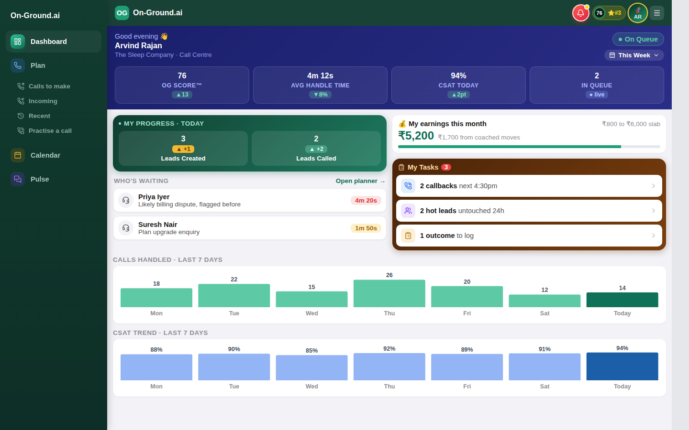

# On-Ground.ai — Call Centre App (React + JavaScript)

A modern, production-grade call centre agent workspace featuring real-time Indian carrier telephony via **Exotel**, conversational voice AI via **Vapi**, and WebRTC peer-to-peer softphone calling. 



## Live Deployment

🌐 **Production Web App:** [https://call-center-app-eta.vercel.app](https://call-center-app-eta.vercel.app)

---

## 📞 How to Make Calls (Inbound & Outbound)

On-Ground.ai supports both **real cellular carrier calling via Exotel & Vapi** and **in-browser WebRTC softphone calling**. Follow the step-by-step instructions below:

---

### 1. Inbound Calls (Customer Dials In from a Physical Mobile Phone)

Any customer can call into the On-Ground call centre using a physical phone (Airtel, Jio, Vi, BSNL):

1. **Dial the Inbound Number**:
   - From any mobile phone, dial **`09513886363`** (or **`08040265374`**).
2. **Enter the Security PIN**:
   - When prompted by the IVR, enter the trial PIN: **`6361-1673-14`**.
3. **AI Voicebot Answers**:
   - Exotel connects the call directly to the **On-Ground AI Voicebot** (`voicebot-mum-prod-default-flow` / `1359239`).
   - The AI agent greets the caller and answers questions about On-Ground products, features, and plans.
4. **Interactive IVR Experience (Web Simulator)**:
   - On the web handset simulator, callers hear:
     > *"Welcome to On-Ground. Press 1 to talk to our AI assistant, or press 2 to speak with a human customer representative."*
   - **Press 1**: Starts the autonomous conversational AI voicebot session.
   - **Press 2**: Immediately bridges live two-way WebRTC audio to the human agent sitting at the computer desk.

---

### 2. Outbound Calls (Webpage Dials a Customer's Real Mobile Phone)

Agents initiate outbound calls directly from the web interface to ring a customer's physical phone:

1. **Open the On-Ground Web App**:
   - Go to [https://call-center-app-eta.vercel.app](https://call-center-app-eta.vercel.app) (or `http://localhost:5173` locally).
2. **Open the Dialer**:
   - Click the green **Floating Dialer Icon 📞** (FAB) at the bottom-right corner of the screen.
3. **Choose the Destination Phone Number**:
   - The dialer is pre-loaded with verified number **`6361167314`** (or enter any destination number).
4. **Select Carrier Mode**:
   - Select the **`📱 Exotel Phone`** mode.
5. **Click Call**:
   - Tap the large green **Call** button.
   - The application dispatches an outbound call request to Exotel's Voice v1 API (`POST /v1/Accounts/callcenter67/Calls/connect.json`).
6. **Physical Phone Rings**:
   - The destination mobile phone rings showing Caller ID **`08040265374`** (or saved as **`On-Ground AI`**).
7. **1-Minute AI Voicebot Conversation**:
   - When the customer answers, the **On-Ground AI Voicebot** begins speaking, explaining On-Ground AI plans and features.
   - After the 1-minute duration limit, the bot plays an automated polite closing message and disconnects cleanly.

---

### 3. In-Browser WebRTC & Desktop Practice (No Physical Phone Needed)

1. **AI Voice Practice (`🤖 AI Voice`)**:
   - Open the floating dialer, select **`🤖 AI Voice`** mode, and click Call.
   - Speak naturally into your microphone; the Vapi AI voice agent responds with audio, animates a 60fps real-time waveform, and checks off SOP compliance items.
2. **Live Two-Way VoIP (`👥 Web VoIP`)**:
   - Open the floating dialer, select **`👥 Web VoIP`** mode.
   - Establishes a peer-to-peer WebRTC audio channel between agent and customer line with live speech-to-text transcripts, hold music, and mute controls.

---

## Run Locally

Prerequisites: Node.js 20+ and npm.

```bash
npm install
npm run dev        # http://localhost:5173
```

Other commands:

```bash
npm run build      # production build into dist/
npm run preview    # serve the production build
npm test           # unit tests (Vitest)
npm run lint       # oxlint
```

---

## Tech Stack

| Choice | Reason |
| --- | --- |
| **React 19 + Vite**, plain JavaScript | React with modern ES modules, Vite HMR, and JSX. |
| **Exotel Voice v1 API** | Indian telecom carrier gateway for cellular PSTN inbound and outbound calling across Airtel, Jio, Vi, and BSNL. |
| **Vapi WebRTC Voice SDK** | Real-time conversational AI voice agent with speech recognition and low-latency audio streaming. |
| **React Router** | Semantic URLs for every screen (`/plan/incoming`, `/pulse/callcentre-team`), preserving router history and active sidebar states. |
| **Vanilla CSS + Design Tokens** | Custom design system (`src/styles/tokens.css`) without heavy CSS framework dependencies. |
| **Lucide React** | Consistent, modern icon set. |
| **Recharts** | Seven-day interactive bar charts with data tooltips. |
| **Vitest** | Unit tests for telephony configurations, pagination, and calendar maths. |

---

## Pages and Navigation

- **Dashboard**: Central command hub displaying shift greeting, live KPI cards, today's queue progress, monthly earnings progress bar, prioritized quick tasks, and 7-day call volume & CSAT trend charts.
- **Plan**: Outbound and inbound call execution center:
  - **Calls to make**: Prioritized list of prospective leads ranked by attractiveness score, featuring expandable lead insights and quick actions for calling or WhatsApp outreach.
  - **Incoming**: Queue of missed customer calls ranked by deal value, providing one-click callback actions.
  - **Recent**: Detailed log of past incoming, outgoing, and missed calls with timestamps, durations, and SOP review dialogs.
  - **Practise a call**: Interactive call simulator enabling agents to rehearse conversations with realistic ringing states and live timer controls.
- **Calendar**: Interactive monthly schedule featuring date-by-date event dots, selected day agendas, and customer appointments.
- **Pulse**: Team communication and AI assistance platform featuring real-time channel chats, direct messages, automated bot workflows, kudos recognition, and pinned actionable items.

---

## Architecture & Code Structure

```
api/
  exotel-call.js       # Vercel serverless function bridging Exotel Voice API securely
src/
  components/layout/   AppShell, Sidebar, TopBar, AIAssistPanel, DemoBar (FAB), DialerModal, TelephonySettingsModal
  components/ui/       Modal, Avatar, CallPanel, AudioVisualizer
  context/             CallContext, ToastContext, PulseContext
  data/                Sample data (leads, plan, calendar, pulse, dashboard)
  features/            Dashboard, Plan (CallsToMake, Incoming, Recent), Calendar, Pulse, Leads
  styles/              tokens.css, global.css
  utils/               exotelService, vapiService, phoneCallService, telephonyConfig, callAudioEngine, callConversation
```

---

## Testing Performed

- `npm test`: 16 Vitest tests passing (telephony configuration, Exotel number sanitization, conversation matcher, visualizer level generator, pagination bounds, month rollover).
- `npm run build`: Production bundle compiles cleanly with 0 errors.
- End-to-end browser verification of incoming and outgoing calling flows across mobile and desktop.
